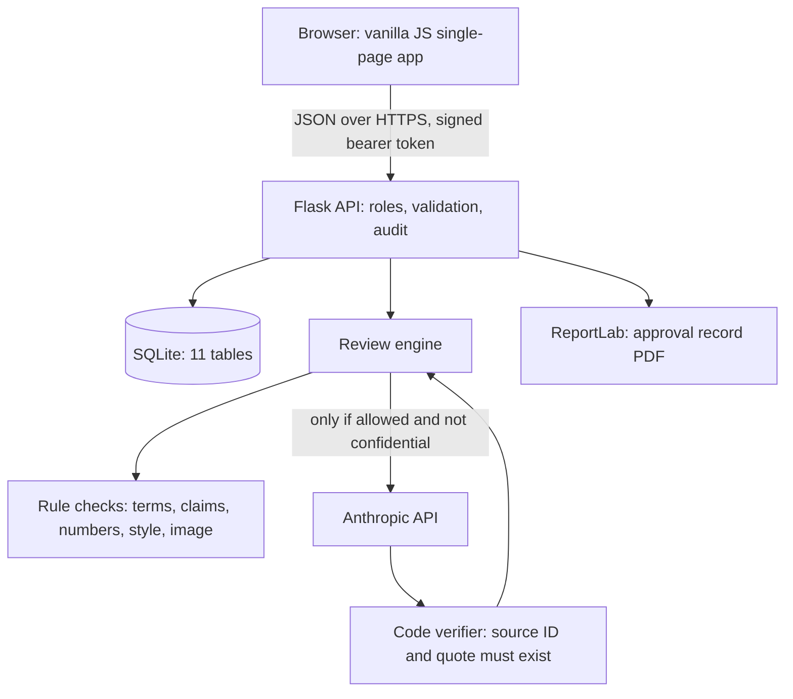

# BrandSure

**Pre-publication brand review you can trust.** Upload your brand rules and approved facts, submit a draft (text or image), and get findings that are explained, source-cited and approved by a human.

Every finding shows: the exact text affected, the rule or approved fact it is based on, a plain explanation, a suggested fix (as a diff), a confidence level, and whether the check was **rule-based** or **AI**. Nothing changes until a person clicks Accept.

- Live demo: **https://brandsure.onrender.com/** (free plan: the first load can take about 30 seconds)
- Demo video: _add link here_

## Try it in 3 minutes

Log in with any demo account (password `demo1234`), or click **Use demo account** on the login page (Manager).

| Role | Email | Can do |
|---|---|---|
| Admin | admin@nova.test | Everything, plus users, AI switch, audit log |
| Manager | manager@nova.test | Edit Knowledge Base, approve, override, Insights |
| Reviewer | reviewer@nova.test | Approve or send back, clear escalated findings |
| Creator | creator@nova.test | Submit drafts, accept/edit/dismiss/escalate findings |

1. Knowledge Base: see the rule "fastest" (Forbidden) and the fact "The Nova app supports 9 languages". Click **Publish version**.
2. New Review: title "Launch post", channel "Social post". Paste:
   `Our app is the fastest in India and now supports 12 languages!!!` then **Run check**.
3. Report: three findings. Open "fastest" (rule C1) and "12" (contradicted by fact F1). Use **Accept fix** and **Edit fix**.
4. **What was checked**: shows which checks were rule-based and which used AI.
5. **Submit for approval**, switch to the Reviewer account, **Approve**.
6. **Compare versions**, then **Insights**, then **Settings > AI and data**.

## Features

| Area | What it does |
|---|---|
| Roles | Admin, Manager, Reviewer, Creator. Each sees only its menu and buttons; the server enforces it (403). |
| Knowledge Base | Guidelines, glossary, approved facts, approved claims, brand colours. Import from DOCX/PDF/MD. Publish numbered versions; every review records the version it used. |
| Rule checks (no AI) | Glossary terms, forbidden / needs-proof claims, numbers compared with approved facts, unsupported superlatives, exclamation marks, ALL CAPS, sentence length, reading ease. |
| Image checks (no AI) | WCAG contrast ratio, missing alt text, palette match, minimum logo size. |
| AI check (optional) | Tone and claim judgement using only the provided sources. **Every AI citation is re-checked in code**: if the quoted source or words do not exist, the finding is downgraded to Unverified or rejected. |
| Confidential mode | Confidential reviews and rules are never sent to an external AI service. An admin switch turns external AI off for the whole workspace. |
| Workflow | Draft, Checked, In review, Changes requested, Approved. High findings block submission until fixed, dismissed with a reason, or overridden by a Manager with a written reason. |
| Versions and history | Every edit is a new version. Word-level diff between any two. Approved versions are locked. |
| Audit log | Every view, accept, dismiss, approve, override and export is recorded (Settings > Audit log, CSV export). |
| Approval record | PDF with approver, time, version, knowledge version and the checks that ran. |
| Insights | Repeated issues, most-dismissed rules, unclear-rule alerts, review speed. Counts only. |

## Architecture

Key design decisions:

- **Rules first, AI second.** Deterministic checks always run, work offline and are the only checks allowed on confidential content.
- **Never trust the model.** The AI must return JSON and quote its source; code verifies the quote. Unsupported claims become Unverified, never guessed.
- **If the AI fails, the report still opens.** Rule findings are kept and the AI check is shown as "could not run".
- **Tenant isolation.** Every query filters by `workspace_id`.
- **Reproducible reviews.** A review is tied to a numbered Knowledge version; approved versions are locked.

### Prototype vs production

This is a working prototype built to be small enough to finish and test. The design submitted in Round 2 describes the production target. Here is how they differ and how the prototype grows into it.

| Area | Prototype (this repo) | Production path |
|---|---|---|
| Frontend | Vanilla JS, no build step | Next.js + TypeScript |
| API | Flask | FastAPI |
| Database | SQLite file, 1 worker | PostgreSQL, connection pooling |
| Retrieval | Sends up to 60 knowledge items to the AI in one prompt | Embeddings + pgvector, top-3 sources per claim |
| AI checks | Run inside the request | Background workers and a queue, result caching |
| Files | Local disk | Object storage |
| Auth | Signed 12-hour token, PBKDF2 passwords | SSO, refresh tokens, rate limiting |

## Run locally

    pip install -r requirements.txt
    python run.py
    # open http://localhost:8000

Environment variables (all optional):

| Variable | Purpose |
|---|---|
| `ANTHROPIC_API_KEY` | Turns on the AI check. Without it only rule-based checks run. |
| `BRANDSURE_MODEL` | Model name for the AI check (default set in `backend/engine.py`). |
| `BRANDSURE_SECRET` | Token-signing secret. If unset, a random one is created in the data folder. **Set it in production.** |
| `BRANDSURE_DEMO=0` | Start empty instead of loading the Nova Foods demo data. |
| `BRANDSURE_DATA` | Data folder (database, uploads). |
| `PORT`, `HOST` | Server address. |

## Tests

    python -m unittest discover -s tests      # 28 API and engine tests
    python tests/catchrate.py --write         # catch-rate test, writes docs/TEST_RESULTS.md
    python run.py &  python tests/e2e.py      # browser walkthrough (needs playwright)

**Catch rate** (rule-based engine, AI off): see [docs/TEST_RESULTS.md](docs/TEST_RESULTS.md). The 28 test cases and their expected findings are written in `tests/catchrate.py`: 22 with expected findings, 4 clean ones to check for false positives, and 2 that only the AI step can catch.

## Deploy on Render (free)

1. Push this folder to a GitHub repository.
2. On render.com: New + > Blueprint > pick the repo. Render reads `render.yaml`.
3. In the Render dashboard add `ANTHROPIC_API_KEY` to turn on the AI check.
4. Open the `.onrender.com` link. Demo logins are the same.

Notes: the free plan sleeps when idle (first load about 30 seconds) and its disk is temporary, so data resets on restart and the demo data is re-created automatically. Keep 1 worker because the database is a SQLite file.

## Known limitations

- **Rules cannot judge meaning.** Jargon ("leverage synergy") and named competitors are only caught by the optional AI step; with AI off they are missed (see test results).
- **Numeric fact matching is keyword based.** A fact is matched by topic words (for example "languages") near a number. Unusual phrasing can be missed.
- **English only.** No other languages yet.
- **Image checks use values the user enters** (text colour, background colour, logo width). The tool does not read pixels from the image.
- **Accuracy depends on the Knowledge Base.** Missing or vague rules mean missing findings; Insights flags rules people often mark as unclear.
- **Prototype scale.** One SQLite file and one worker. Fine for a team, not for hundreds of workspaces.
- **Login token is passed in the URL** for PDF and image downloads (`?t=`). Acceptable for a prototype; production would use short-lived download links.
- **Free hosting** sleeps when idle and resets data on restart.

## Roadmap

1. Round 3: user feedback fixes, AI check live on the deployed site, catch-rate tracking per release.
2. Next: move AI checks to background workers; embeddings and top-k retrieval; reading colours straight from uploaded images.
3. Later: PostgreSQL, SSO, integrations (CMS, email, design tools), more languages, channel-specific rule sets.

## Credits and disclosures

See [DISCLOSURES.md](DISCLOSURES.md) for AI tools, libraries and services used. User feedback is in [docs/USER_FEEDBACK.md](docs/USER_FEEDBACK.md).
